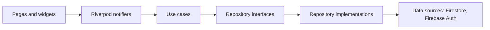

# Blood Donor ISB

[](https://github.com/tahatahirbutt-dev/BloodDonation_App/actions/workflows/ci.yml)

A Flutter app for **Islamabad and Rawalpindi** that connects people who need blood with compatible donors nearby. A person posts a request, matching donors see it and respond, and **a donor's phone number is shared with the requester only at the moment the donor taps "I can help"**.

Built as a solo, production-style project on the free Firebase Spark plan: Clean Architecture, typed error handling, and an automated test suite that includes security-rule tests. It is a portfolio project and is not published on the Play Store.

## Screenshots

<p align="center">
  
  
  
</p>
<p align="center">
  
  
</p>

All names and numbers in the screenshots are fictional test data.

## Features

- Email and password sign-up with email verification.
- Donor profile: blood group, area, last donation date, automatic 90-day eligibility, and two privacy switches ("available to donate", "show me in donor search").
- Post a blood request: blood group, 1 to 10 units, urgency (critical, urgent, planned), and a hospital or blood bank from a fixed list of twin-city places. Requests expire automatically, and one person can have at most 3 open requests.
- Request feed showing only requests this donor can help with (by blood compatibility), most urgent and nearest first, with distance.
- **"I can help"** asks for confirmation, then shares the donor's name and number with that requester only. The donor can withdraw. The requester can copy or call the number, and mark the request fulfilled or cancelled.
- Donor search by blood group, place and radius (5, 10, 25 or 50 km), using geohash queries. Search results never show phone numbers.
- Every screen has explicit loading, empty and error states. Unexpected errors go to Firebase Crashlytics.

## How it is built



- **Feature-first Clean Architecture**: `lib/features/<feature>/{domain,data,presentation}`. Domain code has no Flutter or Firebase imports.
- **Riverpod** with code generation. State is `AsyncValue`, consumed with explicit loading, error and data branches.
- **Typed failures**: data sources throw one exception type, repositories return `Result<T>` with a sealed `Failure` (network, permission, validation, server, unexpected). The UI never sees an SDK exception.
- **Swappable data sources**: every repository works against a Firestore implementation and an in-memory one, and the same contract tests run against both.
- **Privacy in the rules, not just the UI**: the private profile (with phone) and the public donor entry (no phone) are separate documents, and a phone number only appears in a response document that Firestore rules let just the donor and the requester read.

```text
lib/
  bootstrap/       startup, Firebase init, Crashlytics, startup-failure screen
  core/            errors, geo (geohash, distance), time, id generation, shared UI
  features/
    auth/          sign-up, sign-in, email verification, session
    blood_request/ post, feed, respond, manage requests
    donor_profile/ profile, eligibility, privacy switches
    donor_search/  directory search by blood group and radius
  home/            four-tab app shell
rules_test/        Firestore Security Rules tests (emulator)
test/              unit, contract and widget tests
docs/qa/           test plan, manual test cases, defect log
```

## Quality assurance

- **Automated**: run `flutter test` for unit tests (use cases, mappers, repositories, geo maths), contract tests shared by the Firestore and in-memory data sources, and full-app widget flows. Static analysis with `flutter analyze` is clean.
- **Security rules**: 60+ emulator tests in `rules_test/` cover who can read and write each collection, including a 64-pair blood-compatibility check written independently of the rules.
- **CI**: GitHub Actions runs analyze, tests with coverage, the rules tests on the Firestore emulator, and a release APK build on every push.
- **Manual QA documents**: [test plan](docs/qa/TEST_PLAN.md), [manual test cases](docs/qa/TEST_CASES.md), [defect log](docs/qa/DEFECT_LOG.md).

## Run it

Requirements: Flutter 3.38.x, Android SDK. Node.js 24 and Java 21 only for the rules tests.

```bash
git clone https://github.com/tahatahirbutt-dev/BloodDonation_App.git
cd BloodDonation_App
flutter pub get
dart run build_runner build --delete-conflicting-outputs
```

The app needs its own Firebase project, because `android/app/google-services.json` is not committed. Create a Firebase project, register an Android app with package `com.tahabutt.blooddonation`, enable Email/Password sign-in and Firestore, put the downloaded `google-services.json` in `android/app/`, deploy `firestore.rules` and `firestore.indexes.json` (`firebase deploy --only firestore`), then `flutter run`.

```bash
flutter analyze
flutter test --coverage

cd rules_test && npm ci
npx -y firebase-tools emulators:exec --only firestore --project demo-bloodrules "node --test firestore_rules_test.mjs"
```

CI builds the APK only if the repository secret `GOOGLE_SERVICES_JSON_BASE64` holds the base64 of that file. Without it, analyze and tests still run.

## Known limitations

- **No push notifications**: they need Cloud Functions, which need a paid Firebase plan. Donors see requests by opening the app.
- **No server-side rate limit** on posting requests (client checks only), and the feed and directory queries are capped at 50 results.
- Phone numbers are not verified, and sign-in is email and password only.
- Twin cities only, using a fixed list of areas, hospitals and blood banks instead of GPS.
- Firebase App Check is not enabled yet.

## Privacy

See the [privacy policy](docs/privacy-policy.html). In an emergency, call Rescue 1122. The app connects people and is not a medical service.

## Licence

MIT
